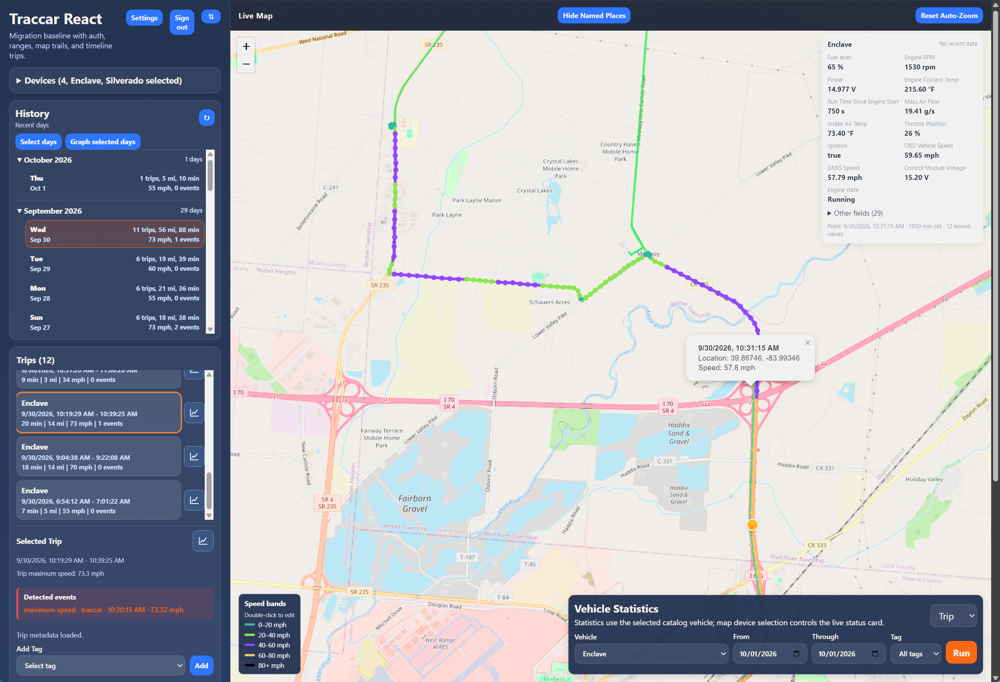
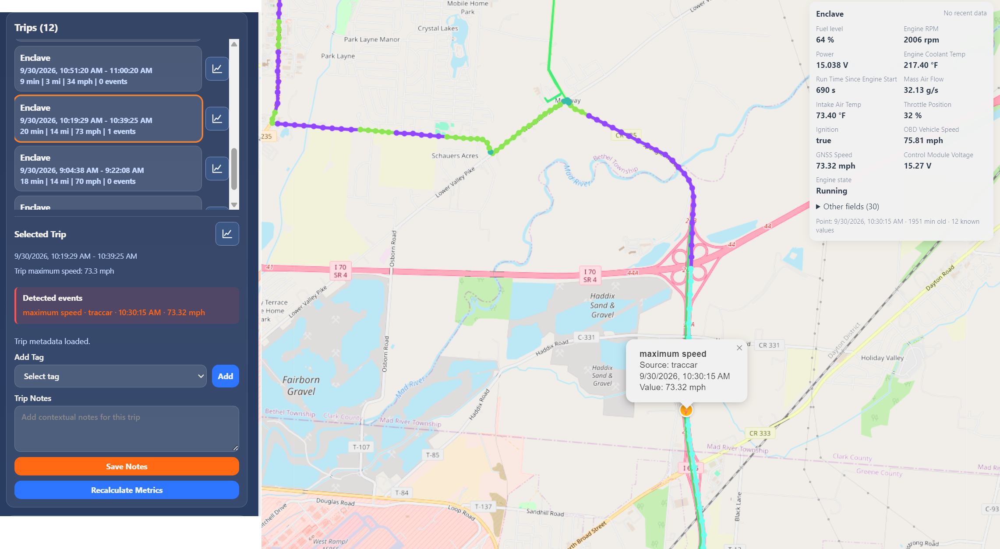
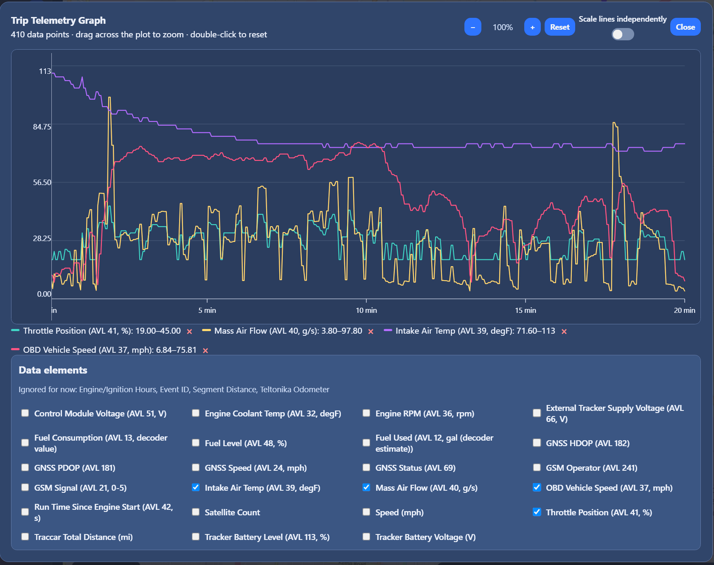

# Traccar React Migration


Traccar-focused telemetry tooling for a full self-hosted vehicle history. Includes Bouncie trip-history import downloading all trip data points. Modern React + Vite frontend with a .NET backend for trip analysis, telemetry, and import workflows.

The backend is **Traccar React API** (`traccar_react_api`). To install Traccar React alongside an existing Traccar server with one script, see the [existing-Traccar installation guide](docs/INSTALL_TRACCAR_REACT_ALONGSIDE_TRACCAR.md). For a clean first-test installation of both apps, see the [automated installation guide on the Wiki](https://github.com/Danvanf/Traccar-React/wiki/Install-Traccar-and-Traccar-React) or its [repository copy](docs/FULL_STACK_INSTALLATION.md). For adding the API to an existing Docker deployment manually, see the [Docker deployment guide](TRACCAR_REACT_API_DOCKER_DEPLOYMENT.md); existing installations should also review the [migration notes](docs/API_NAMING_MIGRATION.md).

## Who This Is For

- People migrating from Automatic or Bouncie who want long-term control of trip history.
- Traccar users who want richer trip analysis, tagging, and diagnostics workflows.
- Self-hosters who want to own their data and avoid monthly platform lock-in.
- Bouncie users who just want to be able to export their trip data points
- People interested in what their vehicles do graphing ODB2 data over time.
- Current Traccar, OwnTracks, Dawarich, FleetStack or even Home Assistant asset tracking users.
- Racers who need data. Track start/finish lines can be defined, then telemetry export data marks runs or laps.
- Anyone who wants to know more about their car.

## License

This project is licensed under AGPLv3. See:

- `LICENSE`
- `LICENSING.md` (plain-language usage and compliance notes)

## License FAQ

- Commercial use is allowed under AGPLv3.
- If someone modifies AGPL-covered backend code and serves it over a network, they must provide corresponding source to users interacting with that service.
- AGPLv3 alone cannot add extra field-of-use restrictions; that requires a separate licensing model.

## What Is Included

- React app shell with persisted API settings
- Leaflet map rendering with live position markers
- Buttons to test API connectivity and load live snapshot data
- Vite dev proxy for `/api` to avoid browser CORS issues during local development
- Bouncie CSV import into the app database if that's all that is available
- Bouncie OAuth connection support with rate-limited backfill workflows to import trip data points.
- User and group definitions to limit views.
- Trip tagging and notes.

## Visual Preview

### Main Map View



### Trip Details View



### Telemetry View



For Settings walkthrough screenshots and section-by-section setup guidance, see:

- `docs/SETTINGS_CONFIGURATION_GUIDE.md`

## Code Structure

- `src/App.jsx`: orchestration and state composition
- `src/components/`: UI sections (`RangeControls`, `StatusCard`, `DeviceList`, `DayPanel`, `TripPanel`, `SettingsModal`)
- `src/lib/settings.js`: settings defaults and persistence
- `src/lib/time.js`: range helpers and datetime-local utilities
- `src/lib/geo.js`: distance and position normalization helpers
- `src/lib/trips.js`: trip detection and day summary logic
- `src/lib/traccarApi.js`: session-aware API client

## Run Locally

```bash
cd traccar-react
npm install
npm run dev
```

Default API base in the app is `/api`.

Traccar React API users authenticate with accounts managed in **Settings > Users and Groups**; those usernames and password hashes are stored in `app_users`. Authentication is independent of server bootstrap credentials, so it remains enabled even when no auth credentials are present in environment variables. The optional `TraccarReactApi:Auth:Username` and `TraccarReactApi:Auth:Password` values are for provisioning a first administrator on a new database, not for normal user sign-in.

For local AI/development access, `backend/TraccarReact.Api/appsettings.Development.json` can set `TraccarReactApi:Auth:AllowUnauthenticatedDevelopment` to `true`. This grants a development admin identity to loopback API requests without a user cookie, while `/auth/status` still reports the actual browser login state so the frontend prompts for and displays a named user. The option is ignored outside `Development`; do not enable it in production.

## Traccar React API Environment Variables

The `scripts/api-environment.sample.ps1` and `scripts/api-environment.sample.sh` templates separate required database/key-ring configuration, first-admin bootstrap, and optional hosting, delivery-limit, and developer diagnostic settings. Replace placeholders before use and keep populated copies private. Email/SMS provider accounts, secrets, webhook settings, and Bouncie authorization are managed in Settings, with no environment fallback. See [API configuration](docs/API_ENVIRONMENT_CONFIGURATION.md) for the complete boundary and the reason each remaining setting belongs on the server.

Source the matching file in the same terminal session used to start the API. PowerShell:

```powershell
. .\scripts\api-environment.sample.ps1
dotnet run --project .\backend\TraccarReact.Api\TraccarReact.Api.csproj
```

Bash:

```bash
source ./scripts/api-environment.sample.sh
dotnet run --project ./backend/TraccarReact.Api/TraccarReact.Api.csproj
```

The primary names use ASP.NET Core's `__` separator for configuration sections (for example, `TraccarReactApi__Email__DailyLimit`). Obsolete aliases and provider credential environment variables are no longer read. The credential key ring uses `TraccarReactApi__CredentialEncryption__ActiveKeyId` and `TraccarReactApi__CredentialEncryption__Keys__<key-id>`; each key value must be Base64 for exactly 32 random bytes. Generate one with `[Convert]::ToBase64String([System.Security.Cryptography.RandomNumberGenerator]::GetBytes(32))` in PowerShell or `openssl rand -base64 32` in Bash. Store backups of these keys separately from PostgreSQL. Losing a key makes credentials encrypted with it unrecoverable. Keep old key IDs available through re-encryption and backup-retention periods.

### Rotate the provider credential key

1. Generate a new random 32-byte key and securely back it up. Give it a new key ID; do not overwrite the old key's value.
2. Configure both keys in the API environment (`...Keys__<old-id>` and `...Keys__<new-id>`) and set `...ActiveKeyId` to the new ID. Restart the API so new credentials use the new key while existing credentials remain readable.
3. As an administrator, send an authenticated `POST` to `/api/admin/provider-accounts/rotate-credentials`. The endpoint re-encrypts stored provider secrets in batches, advances the affected account revisions and records an audit entry. It can be run again safely if interrupted; the response reports how many secret records it rotated.
4. Confirm provider account readiness in Settings. Keep the old key configured until all provider secrets have been rotated and database backups encrypted with that key are outside the retention period. Then remove the old key and restart the API.

If rotation reports that a credential could not be decrypted, the current batch is rolled back. Keep the old key configured and restore the correct key value. If that key is lost, the affected provider secret must be replaced in Settings; do not remove the key that still decrypts other records.

The Graph sender mailbox is configured through the app's Settings rather than an environment variable; this lets it vary independently from API credentials. Provider accounts and webhook secrets are read only from the database. Requests using the installation default cannot send until a default account is selected in Settings. `VITE_*` variables configure the frontend build or development proxy, so they are not included in these API samples.

Administrators can manage Microsoft Graph accounts under Settings > Email Alerts and Twilio accounts under Settings > SMS Test, including per-vehicle account overrides. The API encrypts provider secrets before storing them in PostgreSQL; the browser only sees whether each secret is configured. “Check Graph Credentials” requests an OAuth token from Microsoft Entra but does not verify Graph `Mail.Send` permission or the sender mailbox. “Check Connection” for Twilio verifies its API credentials. Test sends remain separate deliberate actions. New email and automatic SMS alerts retain the selected account when they enter the queue; email alerts also retain the sender mailbox. Changing defaults does not redirect alerts already queued. Keep the configured key ring with the database backups needed to restore these accounts.

Bouncie credentials use the shared key ring. The former standalone Bouncie key and its migration path have been removed. Reconnect in Settings if credentials still use the old format.

## Proxy Target

By default, dev proxy sends `/api` to:

`http://<traccar-host>:8082`

You can override that target:

```bash
VITE_TRACCAR_TARGET=http://<traccar-host>:8082 npm run dev
```

## Screenshots

Place publishable screenshots in:

- `docs/screenshots/`

Capture conventions and recommended views are documented in:

- `docs/screenshots/README.md`

Settings walkthrough and configuration notes are documented in:

- `docs/SETTINGS_CONFIGURATION_GUIDE.md`

## Operations and Validation

This README is intentionally brief. Deep operational steps and scripts live in dedicated docs:

- `AI_OVERVIEW.md` (architecture and current milestone status)
- `TRACCAR_REACT_API_DOCKER_DEPLOYMENT.md` (deployment guidance)
- `scripts/` (schema migrations, smoke tests, regression runners, health/retention SQL)

Quick checks from repo root:

```powershell
npm test
dotnet run --project tests/TripIdentity.Tests/TripIdentity.Tests.csproj
dotnet run --project tests/TripImport.IntegrationTests/TripImport.IntegrationTests.csproj --artifacts-path .artifacts/import-tests
```

## Public Roadmap

- Stabilize status-card attributes with multi-day data validation.
- Finalize fallback editable vehicle fields policy.
- Run first archive batch once retention window eligibility is reached.
- Tune growth thresholds from observed production trends.
- Expand FMB003 and DTC decoding coverage as real hardware payloads require.
